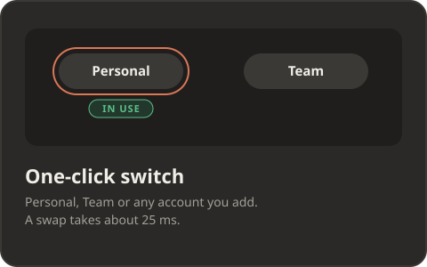
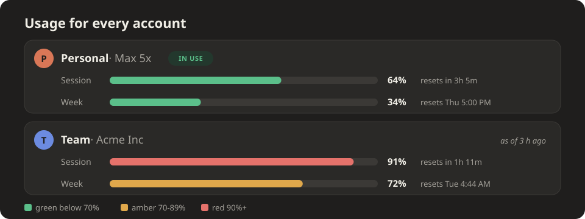

<div align="center">



# CCSwitcherX: switch Claude Code accounts

**Switch Claude Code between your own accounts in one click.**
Keep a personal Max plan and a work Team plan side by side, see each one's usage, and swap from a small window
or from the VS Code status bar. Windows, free, open source.

[](https://mhjoy99.github.io/CCSwitcherX/demo/)
[](LICENSE)


[**Live demo**](https://mhjoy99.github.io/CCSwitcherX/demo/) ·
[**Website**](https://mhjoy99.github.io/CCSwitcherX/) ·
[Install](#install) ·
[How it works](#how-it-works) ·
[FAQ](#faq) ·
[Docs](docs/ARCHITECTURE.md)

</div>

---

## What is CCSwitcherX?

**CCSwitcherX is a free, open-source Windows tool that switches the Claude Code login between your own saved
accounts, for example a personal Max plan and a work Team plan, in one click.** It has a small window (find it by
typing "Claude Accounts" in the Windows search bar), a VS Code status-bar extension and a command line. You sign in to
each account once; after that, switching takes a fraction of a second and nothing is typed or logged out.

It only moves **your own login between your own accounts, on your own computer**. It is independent and unofficial:
not affiliated with Anthropic. Claude and Claude Code are trademarks of Anthropic.

## Features

<table>
<tr>
<td width="50%"></td>
<td width="50%"></td>
</tr>
<tr>
<td width="50%"></td>
<td width="50%"></td>
</tr>
</table>

- **One-click switch.** A swap of two entries in Claude Code's login files measured 21 to 27 ms on a real machine.
- **Usage for every account.** The 5-hour session and 7-day weekly percentages with reset times, per account.
- **VS Code status bar.** `Personal · 64%` in the corner; click it to switch, add, rename or remove accounts.
- **Safe by design.** Logins are encrypted with Windows DPAPI, the current login is backed up before every switch,
  an interrupted switch is finished on the next start, and a failed write is rolled back.
- **Your setup stays the same.** Skills, `CLAUDE.md`, memory, MCP logins and chat history are shared by every account.
- **Self-check.** `doctor` verifies the login files, the encryption, the `claude` command and that Claude Code still
  uses the lock files this tool relies on.

## Install

You need Windows 10 or 11, Python 3.9 or newer (tested on 3.11) with tkinter (the default Python installer includes it),
and, for the status bar, VS Code. There is nothing to `pip install`.

```powershell
git clone https://github.com/MHJoy99/CCSwitcherX
cd CCSwitcherX
powershell -ExecutionPolicy Bypass -File scripts\install.ps1
```

The installer copies the program into `~/.claude-accounts`, creates the **Claude Accounts** Start Menu shortcut,
installs the VS Code extension and runs the self-check. It never touches your saved logins, so running it again to
update is safe. No VS Code or Node.js? Use `-SkipExtension`. Remove everything with `powershell -ExecutionPolicy Bypass -File scripts\uninstall.ps1`
(your saved logins are kept unless you add `-RemoveSavedLogins`).

## Use it

1. **Add each account once.** Open *Claude Accounts* and click **Add account**. A browser tab opens on Claude's own
   sign-in page: pick the account (use *Switch account* on that page if it shows the wrong one), press Authorize and
   give it a name. Your previous login is saved automatically first, and cancelling puts it back.
2. **Switch.** Click **Switch** on another card, or click the account name in VS Code's status bar and pick it.
   Open Claude Code chats pick up the new account on their next message; if one does not, start a new chat.
3. **Watch usage.** Each card shows Session and Week bars with reset times (green below 70%, amber to 89%, red from 90%).





### Command line



```text
python claude_accounts.py list | status | usage | switch NAME | save [NAME] | rename NAME NEW | remove NAME | add | doctor
```

Add `--json` for machine-readable output and `--version` for the version.

## How it works



Claude Code keeps who you are in two places: the `claudeAiOauth` entry of `~/.claude/.credentials.json` and the
`oauthAccount` entry of `~/.claude.json`. CCSwitcherX keeps an encrypted copy of each account's pair and, on a switch,
backs up the current pair, takes Claude Code's own lock files so a token refresh cannot interleave, and replaces
those two entries (and clears one cached flag that Claude Code recreates). Details, including the recovery journal and the usage rules, are in
[docs/ARCHITECTURE.md](docs/ARCHITECTURE.md).

## Safety and privacy

- Saved logins are encrypted with Windows DPAPI: only your Windows user on that PC can read them.
- No server, no telemetry. The only network use is Claude Code's own browser sign-in and a read-only usage request
  made with your own token.
- DPAPI does not protect against malware running as your Windows user. See [SECURITY.md](SECURITY.md).
- Do not commit the `~/.claude-accounts` folder or share it; it holds your saved logins. The repository's
  `.gitignore` already excludes every file the tool writes.

## Limits, stated plainly

- Windows only (the encryption uses DPAPI). macOS and Linux are not supported.
- Built for claude.ai subscription logins (Pro, Max, Team). It does not manage API keys. Tested with real Max and Pro
  accounts; Team accounts use the same login format.
- A saved login stays valid for about 28 days from its last refresh. An account you never use expires; the window warns
  you 7 days ahead.
- Usage for an account you are not using is live only while its saved sign-in is fresh (about 8 hours after you last
  used it); after that you see the last known numbers marked "as of".

## FAQ

**Do I have to log in again every time I switch?** No. You sign in once per account. CCSwitcherX keeps each login
encrypted on your PC and puts the right one back when you switch.

**Does switching change my skills, memory or chat history?** No. Only the login is swapped.

**Is it an official Anthropic tool?** No. It is independent and unofficial; check Anthropic's terms for your plan.

More answers in [docs/FAQ.md](docs/FAQ.md) and on the [website](https://mhjoy99.github.io/CCSwitcherX/#faq).

## How it compares

[claude-swap](https://github.com/realiti4/claude-swap) (macOS, Linux, Windows; terminal tooling and automatic
rotation) and [CCSwitcher](https://github.com/XueshiQiao/CCSwitcher) (a macOS menu-bar app) use the same basic
technique of backing up each account's login and swapping it in; the lock-file protocol written up in claude-swap
informed this project. CCSwitcherX is Windows-first with a graphical window and a VS Code status bar. Pick the tool
that fits your platform.

Works alongside [CCUsageX](https://github.com/MHJoy99/CCUsageX), the author's Claude Code usage dashboard: its plan-limit
card follows the account you switched to, while its cost totals combine all accounts because chat history does not
record which account was used.

## Develop

```powershell
powershell -ExecutionPolicy Bypass -File scripts\test.ps1          # 32 engine tests + 16 extension tests, fake accounts, no windows opened
powershell -ExecutionPolicy Bypass -File scripts\build-vsix.ps1    # builds dist/claude-accounts-<version>.vsix
python -I scripts/check-svg.py docs/assets
python -I scripts/check-site.py
```

```text
src/         the engine (claude_accounts_core.py), the command line and the window
extension/   the VS Code status-bar extension
tests/       engine tests (python) and extension tests (node, mocked VS Code)
scripts/     install, uninstall, test, build, asset and site checks
docs/        the website (GitHub Pages), the live demo, FAQ, architecture notes
```

The tests run against throw-away folders (`CA_CLAUDE_DIR`, `CA_STORE`) and never touch a real login. See
[CONTRIBUTING.md](CONTRIBUTING.md).

## License

[MIT](LICENSE) © 2026 MHJoy99. Not affiliated with, endorsed by or sponsored by Anthropic.
