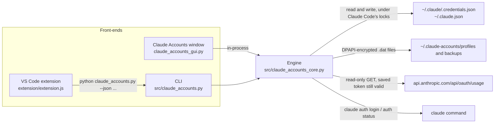

# Architecture

This page describes how CCSwitcherX (the **Claude Accounts** window, the VS Code extension and the `claude_accounts.py` command) works, file by file. Each behaviour names the function that does it, as `file: function`, so you can read the code next to this page.

Everything here is Windows-only. `claude_accounts_core.py` loads `ctypes.windll` at import time, so it cannot run anywhere else.

## Overview

Claude Code keeps one login on the machine. CCSwitcherX saves each account's login (encrypted) and, when you switch, puts the chosen login back into Claude Code's two files. Nothing else in Claude Code's files is changed by a switch.

Design rules that follow from the code:

- **One engine.** The window and the CLI both call `claude_accounts_core.py`. The extension never touches the files itself; it runs the CLI and reads its JSON (`src/claude_accounts.py` docstring).
- **Secrets stay in the engine.** `claude_accounts_core.py: state` returns no tokens, and the extension only shows what `state` returns (`extension/extension.js` header comment).
- **Claude Code's own locks.** Every write that changes the login happens while holding the lock directories that Claude Code uses (see [Lock protocol](#lock-protocol)).
- **No server, no telemetry.** The only network call is the read-only usage request (see [Usage](#usage)). Sign-in is done by Claude Code's own `claude auth login`.

## Files

### Files Claude Code uses

These are Claude Code's files. CCSwitcherX reads them, and writes only the keys named below.

| Path | Purpose | Encrypted | Who writes it |
|---|---|---|---|
| `~/.claude/.credentials.json` (`CREDS`) | OAuth tokens under key `claudeAiOauth`. Other keys (for example `mcpOAuth`) are kept as they are. | No, plain JSON | Claude Code; CCSwitcherX replaces `claudeAiOauth` (`claude_accounts_core.py: apply_login`) |
| `~/.claude.json` (`CLAUDE_JSON`) | Account record under key `oauthAccount`. Also holds Claude Code's usage cache (`cachedUsageUtilization`) and other state. | No, plain JSON | Claude Code; CCSwitcherX replaces `oauthAccount` and removes `cachedExtraUsageDisabledReason` (`apply_login`) |
| `~/.claude/.oauth_refresh.lock/` (directory) | Claude Code's token-refresh lock. CCSwitcherX takes it while switching. | n/a | Claude Code and CCSwitcherX (`claude_accounts_core.py: claude_locks`) |
| `~/.claude.lock/` (directory) | Lock for the `~/.claude` directory. | n/a | Claude Code and CCSwitcherX |
| `~/.claude.json.lock/` (directory) | Lock for `~/.claude.json`. | n/a | Claude Code and CCSwitcherX |
| `~/.vscode/extensions/anthropic.claude-code-*/resources/native-binary/claude.exe` | Read-only scan by the self-check, to see whether the lock name is still in the binary (`claude_accounts_core.py: _lock_name_present`). | n/a | Not written |

Notes:

- `CLAUDE_DIR` is `CA_CLAUDE_DIR`, or else `CLAUDE_CONFIG_DIR`, or else `~/.claude`. If a legacy `.config.json` exists in that folder, it is used instead of `.claude.json` (`claude_accounts_core.py` top-level code).
- The lock directories sit next to the directory they guard: `CLAUDE_DIR.parent / (CLAUDE_DIR.name + ".lock")` and `CLAUDE_JSON.parent / (CLAUDE_JSON.name + ".lock")`.
- Everything else in those files (skills, CLAUDE.md, memory, MCP logins, chat history and every other key) is not read for writing and is not changed by a switch. The test `test_switch_roundtrip_preserves_everything_else` in `tests/test_core.py` checks the `mcpOAuth`, `numStartups` and project-history keys after a round trip.

### Files CCSwitcherX keeps

All of these are under the app folder `~/.claude-accounts` (`STORE`), or `CA_STORE` when that variable is set. The app folder is never inside the repository.

| Path | Purpose | Encrypted |
|---|---|---|
| `~/.claude-accounts/claude_accounts.py`, `claude_accounts_core.py`, `claude_accounts_gui.py`, `icon.ico`, `icon.png` | Program files, copied by `scripts/install.ps1` | No |
| `~/.claude-accounts/profiles/<id>.dat` | One saved login: `name`, `createdAt`, `updatedAt`, `claudeAiOauth`, `oauthAccount` (`save_profile`) | Yes, DPAPI |
| `~/.claude-accounts/backups/<YYYYmmdd-HHMMSS-ffffff>.dat` | Copy of the login that was active before a switch or an add. The newest 10 are kept (`backup_live`, `KEEP_BACKUPS`). | Yes, DPAPI |
| `~/.claude-accounts/switch.journal` | `{"target": <id>, "at": <epoch seconds>}`, present only during a switch that has not finished (`switch_to`, `recover`). Holds no tokens. | No |
| `~/.claude-accounts/usage.json` | Usage numbers per account id, plus `fetchedAt`, `source`, `retryAt`, `error`. Holds no tokens (see [Usage](#usage)). | No |
| `~/.claude-accounts/login.log` | Output of `claude auth login` during Add account. Deleted when the sign-in ends (`add_login`). | No |
| `~/.claude-accounts/doctor-cache.json` | `{"key": ..., "hit": ...}` cache of the lock-name scan (`_lock_name_present`). | No |
| `%APPDATA%\Microsoft\Windows\Start Menu\Programs\Claude Accounts.lnk` | Start Menu shortcut, made by `scripts/install.ps1` | n/a |
| VS Code extension `local.claude-accounts` | Status bar and picker, installed by `scripts/install.ps1` from a built `.vsix` | n/a |
| `%TEMP%\claude-accounts-cancel-<pid>-<ms>` | Cancel marker the extension creates when you cancel Add account; the CLI reads it and the extension deletes it (`extension.js: addAccount`, `claude_accounts.py: main`) | No |
| `*.ca-<pid>.tmp`, `*.tmp` next to a file | Temporary files used for atomic writes (`write_json`, `_write_bytes`); replaced immediately | Matches its target |

The window is single-instance: a named mutex `Local\ClaudeAccountsGUI-<8 hex digits of sha1(STORE)>` is created in `claude_accounts.py: run_gui`, and a second launch exits quietly.

## Switch algorithm

`claude_accounts_core.py: switch_to(pid)` does the following, in order.

1. **Look up the target.** If the id is not saved, raise `SwitchError` ("That account is no longer saved.").
2. **Take all three Claude Code locks** with `claude_locks()` (see [Lock protocol](#lock-protocol)). Everything from step 3 to step 9 runs under them, so a token refresh cannot slip in between "save the old tokens" and "write the new ones".
3. **Read the live login** with `read_live()`. A login counts only if it has `claudeAiOauth` with a `refreshToken` and an `oauthAccount`. If there is no live login, skip to step 6.
4. **If the live account is the target**, call `sync_back(live)`, return `changed: False`, and stop. Nothing else is written.
5. **Save the outgoing login.**
   - If the live account is already saved, `sync_back(live)` writes its rotated tokens back into its `.dat` file.
   - If it is not saved, `save_profile(live)` saves it under a suggested name ("Personal", "Team", "Enterprise", or with a number suffix). The name is returned as `autosaved`.
   - Then `backup_live(live)` writes a DPAPI copy to `backups/`, and keeps only the newest 10.
6. **Check the target's sign-in.** If `refresh_expired(target)` is true (`refreshTokenExpiresAt` is in the past), raise `SwitchError` ("The saved sign-in ... has expired. Use "Add account" ..."). Note that step 5 has already run by this point, so a refused switch can still leave a new autosave and a new backup behind.
7. **Write the journal.** `switch.journal` is written with the target id and the time, so that a process killed mid-switch can be finished later.
8. **Apply the login** with `apply_login(target.claudeAiOauth, target.oauthAccount)` (see below).
9. **Remove the journal** in a `finally` block. A clean failure has already been rolled back by `apply_login`, so nothing is left to finish.

Return value: `{"name", "changed", "autosaved", "reverted"}`. `reverted` is initialised to `False` and is never set to `True` anywhere in this version.

### apply_login and rollback

`claude_accounts_core.py: apply_login(oauth, acct)`, under `claude_locks()`:

1. Read `.credentials.json` and `.claude.json` as text. If either parses to something other than a JSON object, stop with "Nothing was changed". A malformed file raises a JSON error instead, and the switch stops before any write.
2. Keep a deep copy of the credentials (`old_creds`).
3. Set `claudeAiOauth` in the credentials and write the file atomically (`write_json`, which keeps the file's indented or compact style).
4. Set `oauthAccount` in `.claude.json`, remove `cachedExtraUsageDisabledReason`, and write that file atomically.
5. If step 4 raises, write `old_creds` back to the credentials file and re-raise.

Two consequences to know:

- The rollback write uses the same `write_json`. If the rollback itself fails, that error is what propagates, and the two files can be left out of step. The journal is removed in `switch_to`'s `finally`, so nothing retries it in that case.
- `write_json` and `_replace` retry `os.replace` for up to 30 tries of 0.2 s when another program holds a file, then raise "is locked by another program".

### Journal and recover

`claude_accounts_core.py: recover()` finishes a switch that was interrupted:

- It reads the journal. If there is no journal, or it is unreadable, return `None`.
- If the journal is younger than 20 seconds, return `None`. A switch is probably still running.
- Otherwise it deletes the journal, then, if the target still exists and its sign-in has not expired, calls `apply_login` again and returns the target's name.

`recover()` runs before every CLI command except `recover` itself (`claude_accounts.py: main`), and on every window tick, every 2.5 seconds, when no task is busy (`claude_accounts_gui.py: tick`).

Limitation: `recover()` deletes the journal before it re-applies the login. If the re-apply then fails, the journal is gone and the switch is not retried.

### settle_check

`claude_accounts_core.py: settle_check(pid)` runs after a switch that actually changed the login. Claude Code can still be running and write the old account back, so this function looks again:

- Up to two rounds: sleep 1.2 s, read the live login, return `True` if its account matches the target. Otherwise call `apply_login` again.
- A final sleep of 1.2 s and one more check.

It returns `True` or `False`. The switch is already in effect when this runs. The window (`claude_accounts_gui.py: confirm_in_background`), the extension (`extension.js: confirmInBackground`, which calls the CLI's `settle` command) and the CLI's text mode (`claude_accounts.py: main`, `switch` branch) all call it in the background or after the result is shown.

### Lock protocol

Claude Code guards token refresh and `.claude.json` writes with `proper-lockfile`-style directory locks. CCSwitcherX uses the same protocol so that a swap cannot land inside a refresh. The protocol and the lock name were checked against the Claude Code bundle by claude-swap (see [Credits](#credits)). The protocol is written up in the comments above `CREDENTIALS_STALE_S` in `claude_accounts_core.py`.

| Item | Value | Where |
|---|---|---|
| Acquire order | 1. `CLAUDE_DIR/.oauth_refresh.lock` 2. `CLAUDE_DIR.parent/<name>.lock` 3. `CLAUDE_JSON.parent/<name>.lock` | `claude_locks()` |
| Taking a lock | `os.mkdir`; on `FileExistsError`, wait 0.25 to 0.5 s (random) and retry | `_dir_lock()` |
| Give up after | `LOCK_WAIT_S = 9.0` s, then "Claude Code is refreshing its login right now. Try again in a few seconds." | `_dir_lock()` |
| Stale after (credential locks) | `CREDENTIALS_STALE_S = 60.0` s since the directory's mtime. An older lock is removed and retaken. | `_dir_lock()` |
| Stale after (config lock) | `CONFIG_STALE_S = 10.0` s | `_dir_lock()` |
| Keep-alive | A daemon thread touches the lock directory every `TOUCH_EVERY_S = 3.0` s | `_dir_lock()` |
| Release | Stop the keep-alive thread, then `os.rmdir` the lock directory | `_dir_lock()` |
| Re-entry | A thread-local flag (`_lock_state.held`) makes a nested `claude_locks()` a no-op, so `switch_to` can call `apply_login` | `claude_locks()` |

The release order is the reverse of the acquire order because the three context managers are nested in a single `with`.

## Saved-login storage

### Encryption

`claude_accounts_core.py` calls `CryptProtectData` and `CryptUnprotectData` from `crypt32` through `ctypes`, with description `"ClaudeAccounts"`, no optional entropy and flags 0 (user scope). Only the Windows user who encrypted the data can decrypt it (`protect`, `unprotect`, `_encode`, `_decode`). Saved logins (`profiles/*.dat`) and backups (`backups/*.dat`) are encrypted this way. Each file holds one JSON object encrypted as a whole.

`doctor` checks this with a round trip (`claude_accounts_core.py: doctor`, "Saved logins encrypted").

### Profile id

`profile_id(acct)` is the first 12 hex digits of `sha1("<accountUuid>:<organizationUuid>")`. That is the file name of the `.dat` file. The same person in two organisations therefore gets two profiles, and signing in again with the same account and organisation reuses the same file.

### What a saved file holds

`save_profile(live, name)` writes `{name, createdAt, updatedAt, claudeAiOauth, oauthAccount}`. A new profile gets `name` from the argument, or from `suggest_name`. An existing profile keeps its name unless one is given. Names are unique without regard to case.

### sync_back

Claude Code rotates the refresh token while it is in use, so the saved copy can go stale. `claude_accounts_core.py: sync_back(live)` fixes that: if the live account is saved and its tokens differ from the saved copy, `save_profile` writes the live tokens into the existing file, keeping the name. `sync_back` runs in:

- `state()`, which the window, the CLI and the extension call on every refresh;
- `switch_to`, for the outgoing account;
- `add_login`, before a new sign-in.

## Usage

Usage is the 5-hour **Session** window (`five_hour`) and the 7-day **Week** window (`seven_day`), plus any weekly per-model limits (`limits` with `kind == "weekly_scoped"`). `parse_usage` reads these from the API response format.

### Three sources

| Source | When it is used | Network |
|---|---|---|
| Claude Code's cache, `cachedUsageUtilization` in `~/.claude.json` | For the **active** account, only if the cache belongs to it (same `accountUuid`) and is less than `CLAUDE_CACHE_MAX_AGE_S = 600` s old (`_claude_cached_usage`, `refresh_usage`) | None |
| `GET https://api.anthropic.com/api/oauth/usage` (`_fetch_usage`) | For any account whose access token is still valid (`expiresAt` more than 60 s away). Headers: `Authorization: Bearer <access token>`, `anthropic-beta: oauth-2025-04-20`, `User-Agent: claude-accounts/1.0`. Timeout 8 s. | Yes, one request |
| Last known numbers in `usage.json` | Always kept. Shown with an "as of" note when older than `USAGE_LIVE_S`. | None |

### Safety rules

These are in `claude_accounts_core.py: refresh_usage`:

- **Never refresh a saved login to read usage.** If the access token is missing or expires within 60 s, the account is reported as `token-expired` and left alone. Refreshing would rotate its refresh token.
- **Minimum gap.** One request per account every `USAGE_MIN_GAP_S = 180` s. `usage --force` (and the window's Refresh usage button) skips this gap only.
- **Backoff.** After any error, `retryAt` is set `USAGE_BACKOFF_S = 600` s ahead. For HTTP 429, the wait is the larger of 600 s and the `Retry-After` header. Backoff is checked before `force`, so `force` does not bypass it.
- **No network in tests.** When `CA_NO_NETWORK` is set, `_fetch_usage` raises at once, which counts as an error and starts a backoff.
- **Errors keep the last numbers.** An exception keeps the old values and records `error` (the HTTP status or the exception name).

The constants, all in `claude_accounts_core.py`:

| Constant | Value | Meaning |
|---|---|---|
| `USAGE_MIN_GAP_S` | 180 | Minimum seconds between requests for one account (not for `--force`) |
| `USAGE_BACKOFF_S` | 600 | Wait after an error, or after HTTP 429 when `Retry-After` is smaller |
| `USAGE_LIVE_S` | 900 | Numbers older than this get the "as of ..." note and count as stale |
| `CLAUDE_CACHE_MAX_AGE_S` | 600 | Maximum age of Claude Code's own cache that is trusted |

### What usage.json holds

`usage.json` maps a profile id to an entry:

- `session` and `week`: `{"pct": float, "resetsAt": epoch seconds or null}`
- `models`: list of `{"name", "pct", "resetsAt"}` for weekly per-model limits
- `fetchedAt`: epoch seconds of the last successful read
- `source`: `"claude"` (Claude Code's cache) or `"api"`
- `retryAt` and `error`: set after a failure

It holds percentages and times only. It has no tokens and no email addresses.

### How numbers are shown

- `usage_view` turns an entry into display text. A window whose reset time has passed shows `"Session reset"` and no percentage (`_window_view`, `over`).
- Colours: under 70% is green, 70 to 89% is amber, 90% and up is red (`claude_accounts_gui.py: render_usage`).
- The status bar hides the session percentage when the numbers are stale or the window has rolled over (`extension.js: render`).

## Add-account flow

`claude_accounts_core.py: add_login(cancelled, timeout=600)`:

1. **Protect the current login.** If a login is active, it is saved first: `sync_back` if it is already saved, otherwise `save_profile` under a suggested name. Then `backup_live` writes a copy. Nothing is logged out.
2. **Start the sign-in.** `start_login` runs `claude auth login --claudeai` with stdin closed, output to `login.log`, and no console window. The `claude` command is found with `shutil.which`.
3. **Poll every 0.3 s** until one of these happens:
   - `cancelled()` returns true (the window's Cancel button, the window's close button, or the extension's cancel marker file);
   - the process exits;
   - 600 s pass.
4. **Stop the process tree** if it is still running (`kill_tree`, which runs `taskkill /T /F`). Read the last line of `login.log`, then delete the log.
5. **Compare** the login before and after. "Unchanged" means the same account and the same `claudeAiOauth`.
6. **Restore on failure or cancel.** If the outcome is not a clean finish, or the exit code is not 0, and the login changed, `restore_live(before)` writes the previous login back under the locks. A sign-in that was cancelled therefore cannot leave you signed out of the previous account.
7. **Save the result.**
   - A known profile is refreshed with `save_profile`, and reported as `same` (the same account as before) or `known` (another saved account).
   - A new profile is saved at once under a suggested name and reported as `new`. The window and the extension then ask for a better name, and call `rename_profile` if you give one.

Statuses: `new`, `known`, `same`, `cancelled`, `failed`, `timeout`.

Edge case: if you were signed out before the add (so there is no previous login to restore) and the sign-in had already written a login when you cancelled, that login is kept and shows as not saved. The window then offers "Save it".

## CLI contract for the extension

`src/claude_accounts.py` is the command the extension runs. The extension calls it as `python <appDir>/claude_accounts.py --json <command> [args]`, so `--json` comes before the command. With `--json`, each command prints one JSON object on its last line. `extension.js: run` parses the last line of stdout.

On a `SwitchError` (a problem a user can read), every command prints `{"ok": false, "error": "..."}` and exits with code 1. Any other exception is a traceback on stderr with no JSON; the extension then shows the last line of stderr.

Every command runs `recover()` first, except `recover` itself.

| Command | Extra arguments | JSON result |
|---|---|---|
| `state` | none | `{"signedIn", "active", "unsaved", "profiles"}`. `active` is the id of the active saved account or `null`. `unsaved` is `null` or `{"email", "plan", "detail", "team"}`. Each profile is `{"id", "name", "email", "plan", "detail", "team", "active", "expired", "daysLeft", "usage"}`. `usage` is `null` or `{"session", "week", "models", "ageS", "stale", "text", "resets", "note"}`, where `session` and `week` are `{"pct", "resetsAt", "over"}` or `null`. |
| `list` | none | The same object as `state` |
| `status` | none | `{"active": <profile or null>, "unsaved", "signedIn"}` |
| `save` | `[NAME]` | `{"ok": true, "id", "name"}` |
| `switch` | `NAME` | `{"name", "changed", "autosaved", "reverted", "ok": true, "id"}`. `changed: false` means the account was already active. The CLI does not run `settle` in JSON mode; the caller does. |
| `settle` | `NAME` | `{"ok": <stuck>, "verified": true, false or null}`. `verified` is `null` when the `claude` command could not be asked. |
| `rename` | `NAME NEW_NAME` | `{"ok": true, "name"}` |
| `remove` | `NAME` | `{"ok": true}` |
| `add` | `[--cancel-file FILE]` | `{"status", "ok", "id", "name", "detail"}`. `ok` is true for `new`, `known` and `same`. `detail` is the last line of the sign-in log and is only set on failures. |
| `usage` | `[--force]` | `{"ok": true, "report": {<id>: <status>}, "usage": {<id>: <usage view or null>}}`. Statuses: `claude-cache`, `backoff`, `recent`, `token-expired`, `fetched`, `http-<code>`, or an exception name. |
| `doctor` | none | `{"ok", "checks": [{"name", "ok", "detail"}]}` |
| `recover` | none | `{"ok": true, "recovered": <name or null>}` |

`--version` prints `CCSwitcherX <version>`. The version is `__version__` in `claude_accounts_core.py`.

Without `--json`, the same commands print text. `list` prints one line per account, marks the active one with `*`, and adds a `!` line for an unsaved login.

## VS Code extension

`extension/extension.js` is a front-end only. Its settings are `claudeAccounts.pythonPath` (default `python`) and `claudeAccounts.appDir` (default `~/.claude-accounts`).

### Status bar

`extension.js: render`:

| State | Text | Click |
|---|---|---|
| Active account saved | `$(account) <name>` plus ` · <session %>` when the numbers are fresh and the window has not rolled over. A warning icon is added when another saved sign-in is expired or has under 5 days left. | Opens the picker (`claudeAccounts.switch`) |
| Login active but not saved | `$(warning) Claude: save this login` | Save it |
| Not signed in | `$(sign-in) Claude: not signed in` | Add account |
| Engine cannot run | `$(error) Claude Accounts` | Shows the log |

### Picker

`extension.js: showPicker` opens a quick pick. It starts `usage` in the background first, then lists:

- an unsaved login, if there is one, as "Save current login…";
- each saved account, with its usage line. Expired sign-ins show "Sign-in expired". Other saved sign-ins with under 7 days left show a warning with the days left;
- "Add account…", "Refresh usage", "Open manager window", "Run self-check".

Each account row has Rename and Remove buttons.

### Timers and file watching

| Mechanism | Interval | What it does |
|---|---|---|
| `setInterval` `poll` | 60 s | Runs `state` (skipped while busy) |
| `setInterval` `usagePoll` | 5 min | Runs `usage` unless the last one was less than 120 s ago |
| `fs.watchFile` | 2 s | Watches `~/.claude.json` and `~/.claude/.credentials.json`. A change triggers `state` if the last refresh was more than 2.5 s ago. |
| Window focus | on focus | Runs `state` |
| Startup | at activation | `state`, then `usage`, then a quiet `doctor` four seconds later |

The watched paths are built from `os.homedir()`. They do not follow `CA_CLAUDE_DIR` or `CLAUDE_CONFIG_DIR`, so the extension does not notice changes in a non-default Claude folder. The engine does honour those variables.

### Switching and confirmation

A switch runs `switch`, then refreshes the status bar, then runs `settle` in the background. If `settle` reports that the old account came back, the extension warns that a running Claude Code session is putting it back. If the `claude` command does not confirm the account, it warns of that.

### Self-check at startup

`extension.js: runDoctor(true)` runs `doctor`. If something fails, it shows a warning naming the failed checks, with a "Show details" button that opens the log. If everything passes, it stays quiet.

## Self-check (doctor)

`claude_accounts_core.py: doctor` runs these checks:

| Check | Passes when |
|---|---|
| Login file found | `.credentials.json` exists and has `claudeAiOauth`. A signed-out machine fails this check. |
| Account record found | `.claude.json` has `oauthAccount` |
| Saved logins encrypted | A DPAPI encrypt and decrypt round trip returns the same value |
| claude command found | `shutil.which("claude")` finds it |
| Saved accounts | Always passes; the detail shows the count |
| Claude Code's lock names unchanged | The newest `claude.exe` under `~/.vscode/extensions/anthropic.claude-code-*` contains the bytes `.oauth_refresh.lock`. The scan result is cached per file size and mtime in `doctor-cache.json`. |

Limitation: if no VS Code copy of Claude Code is found, the lock check passes with the detail "no VS Code binary found to inspect". It does not test a terminal-only install.

## Tests

`powershell -ExecutionPolicy Bypass -File scripts\test.ps1` runs two suites. Neither one uses your real login.

**Engine tests** (`tests/test_core.py`). The file sets `CA_CLAUDE_DIR` and `CA_STORE` to a new temporary folder and sets `CA_NO_NETWORK=1` before it imports the engine. Fake accounts are built in code. The file has 32 test methods, covering DPAPI round trips, save, rename and remove, switch round trips, rotated tokens, autosave, the expired refusal, rollback after a failed second write, lock behaviour and more.

**Extension tests** (`tests/test_extension.js`). `test.ps1` creates a sandbox with `tests/make_sandbox.py`, sets `CA_CLAUDE_DIR` and `CA_STORE` to folders in it, and runs the test. The test loads the real `extension/extension.js` with `Module._load` replaced, so `require('vscode')` returns a mock. The mock records messages and quick-pick items, and answers input boxes from preset values. The engine itself runs as a real Python subprocess against the sandbox, so Python must be on `PATH`. A full run reports 16 passed checks.

If Node.js is not installed, `test.ps1` skips the extension tests and says so.

## Limitations and known edge cases

- **Windows only.** DPAPI and `ctypes.windll` are required at import time.
- **Same Windows user only.** A process running as the same user can decrypt saved logins (see [SECURITY.md](../SECURITY.md)).
- **Expired saved sign-ins are refused.** The switch fails with a message, and the account's card is greyed out. Signing in again is the only fix.
- **A refused switch still autosaves.** The order in `switch_to` means the outgoing login is saved and backed up before the expiry check.
- **Accounts you have not used in a while have old usage numbers.** Their access token has expired, so the engine does not read them. The numbers say "as of ...".
- **`recover()` does not retry a failed re-apply** (see [Journal and recover](#journal-and-recover)).
- **The rollback in `apply_login` can itself fail**, leaving the two files out of step until you switch again.
- **`reverted` is never set** in the result of `switch_to`.
- **The extension watches only `~/.claude`**, not a folder set with `CLAUDE_CONFIG_DIR`.
- **The lock check in doctor is a string search** of the newest VS Code binary. It cannot see a terminal-only install.
- **A cancelled sign-in while signed out** can leave the new login active and unsaved (see [Add-account flow](#add-account-flow)).
- **The lock protocol depends on Claude Code.** If Claude Code changes its lock names, switches may not be coordinated with its refreshes. The self-check is there to notice that.

## Credits

- **claude-swap** ([github.com/realiti4/claude-swap](https://github.com/realiti4/claude-swap), `src/claude_swap/claude_locks.py`) documented the lock protocol that `claude_accounts_core.py` follows, and it was checked against the Claude Code bundle. The write-up is in the comments above `CREDENTIALS_STALE_S` in `src/claude_accounts_core.py`.
- **CCSwitcher** (a macOS menu-bar app) and **claude-swap** are the prior art for the basic idea of backing up and swapping logins.
